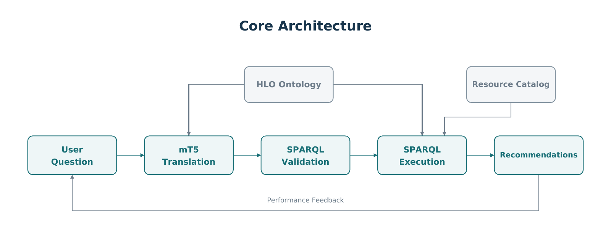

# HLO Recommender

Research implementation of ontology-grounded mT5 query generation, BKT mastery tracking, gap detection, and context-aware resource ranking.



## Setup

```bash
python -m venv .venv
python -m pip install -e .
python -m unittest discover -s tests -v
hlo inspect
```

Activate the environment before installation. Use `pip install -e ".[model]"` for mT5 and Dueling Double DQN.

## Run

```bash
hlo data validate --directory data/development
hlo demo --output artifacts/demo/run-001
hlo experiment --config configs/experiment.toml
hlo recommend --generator template --question "Find resources for arterial blood gas interpretation" --level Junior --minutes 15
```

The template generator is an explicit baseline. mT5 inference requires a fine-tuned checkpoint.

## One-command training and Colab

For an end-to-end development run (dependency installation, tests, actual BKT and mT5
optimization, held-out evaluation, metrics, plots, and recommendations), use:

```bash
python tools/hlo_train_all.py --mode synthetic
```

Use a Python 3.11+ environment with a CUDA GPU; this command downloads
`google/mt5-small` if it is not already cached. You can validate the dataset and
planned stages without installing models or training:

```bash
python tools/hlo_train_all.py --mode synthetic --dry-run
```

Google Colab users can open the
[one-click notebook](https://colab.research.google.com/github/asgmodel/recommendation-system/blob/main/Notebook/Colab/HLO_One_Click_Full_Training.ipynb),
enable GPU under Runtime settings, and run its single code cell. It is self-contained
and does not require uploading a second Python file. Dataset statistics,
training history, held-out metrics, BKT prediction charts, ranking comparisons,
and recommendation plots are displayed as the cell runs and saved in the
run directory.

**Data provenance:** The checked-in development set is synthetic (45 questions,
1,600 assessment events, 30 resources). Training on it updates model parameters,
but is **not** evidence of real-world learning or recommendation performance.
For reviewed human-generated data, supply the required train/validation/test
JSONL files under `data/reviewed/` following [data contracts](docs/data_contracts.md),
then run `python tools/hlo_train_all.py --mode reviewed`.
The separate Dueling Double DQN policy is trained only when reviewed
`transitions.train.jsonl` and `transitions.validation.jsonl` exist;
`--require-policy` fails early if they are absent.

Unique run outputs are written to `artifacts/full-*/`, including mT5 checkpoints,
BKT model parameters, evaluation reports and charts. The script uses mT5 batch
size 1 by default to reduce GPU memory needs; GPU availability, runtime limits,
and model-download access still determine whether a particular Colab session
can finish. Use `--save-to-drive` in Colab to copy completed artifacts to Drive.

## Train

```bash
hlo download --model google/mt5-small --output artifacts/base/mt5-small
hlo train mt5 --config configs/mt5.toml
hlo train bkt --config configs/bkt.toml
hlo train policy --config configs/policy.toml
```

Research configurations expect reviewed files under `data/reviewed`. To test training on synthetic examples:

```bash
hlo train mt5 --config configs/mt5.development.toml --allow-synthetic --check-only
hlo train mt5 --config configs/mt5.development.toml --allow-synthetic
hlo train bkt --config configs/bkt.development.toml --allow-synthetic
```

## Evaluate

```bash
hlo evaluate queries --generator mt5 --checkpoint artifacts/mt5/run-001/checkpoint --data data/reviewed/questions.test.jsonl --output artifacts/evaluation/queries-001
hlo evaluate bkt --model artifacts/bkt/run-001/model.json --data data/reviewed/assessments.test.jsonl --output artifacts/evaluation/bkt-001
hlo experiment --config configs/experiment.toml --generator both --checkpoint artifacts/mt5/run-001/checkpoint --output artifacts/experiments/mt5-001
```

Use a new output directory for each run. Checkpoints, histories, predictions, metrics, input hashes and environment versions are saved together.

## Layout

```text
configs/              Model, runtime and experiment settings
data/ontology/        Original HLO LLM ontology and source hash
data/development/     Synthetic resources, questions and assessments
data/reference/       Preserved results from the supplied project
docs/                 Data contracts and experimental protocol
examples/results/     Executed development checks and experiments
src/hlo_recommender/  Models, pipeline, training and evaluation
tests/                Functional and methodological checks
```

The ontology is preserved byte for byte. The resource catalog is separate and uses a declared duration extension. Development data and saved development results are synthetic. Pretrained and fine-tuned mT5 weights are not distributed. Dueling Double DQN is an optional transition-based experiment and is not enabled in the default recommendation pipeline.

## Notebooks

[Notebook workflows](Notebook/README.md) cover data, training, SPARQL execution, evaluation and adaptive recommendation using the existing package.
